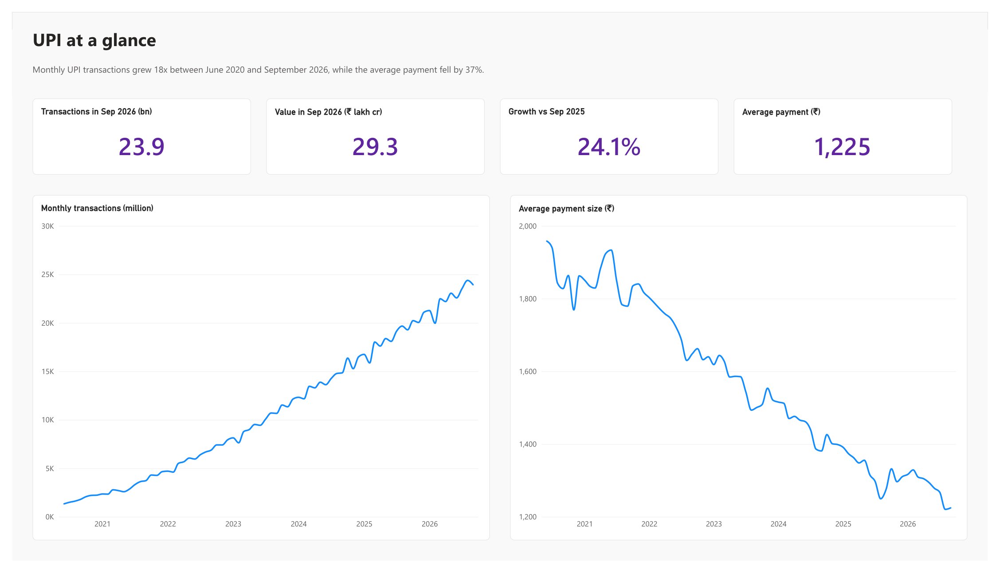
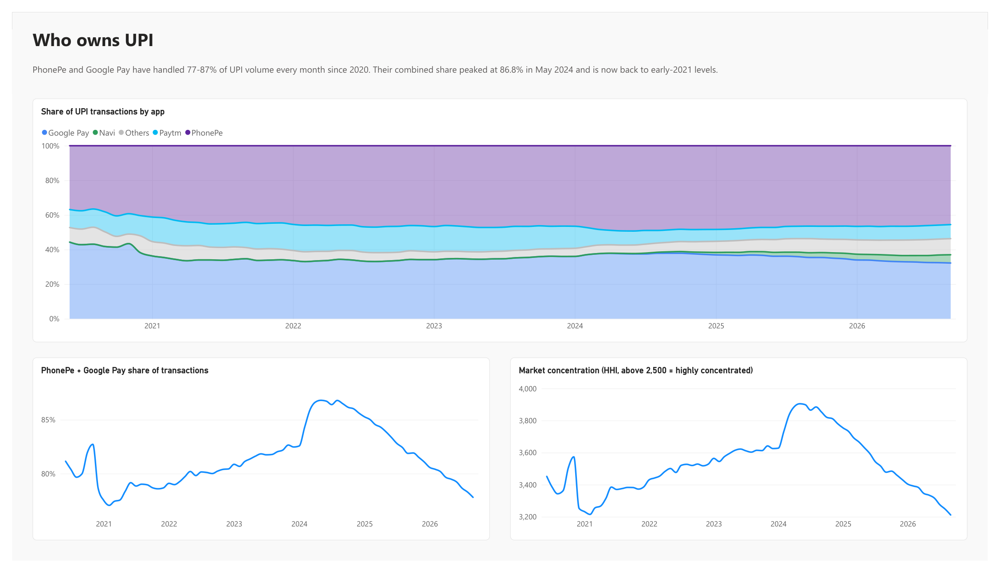
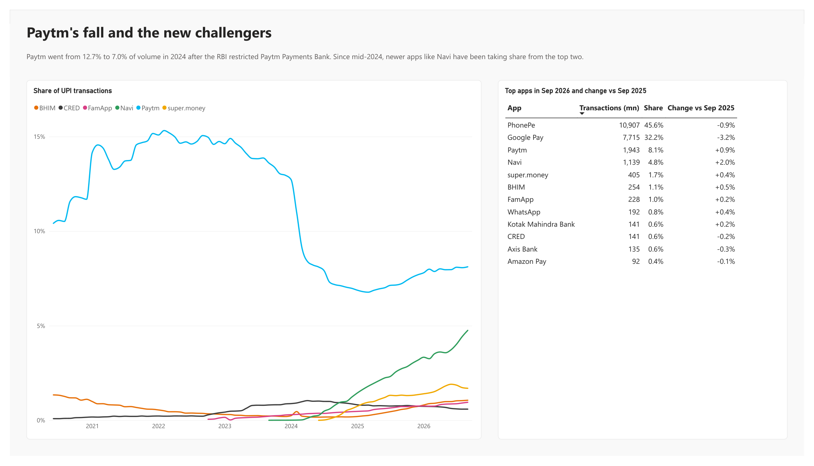

# UPI payments dashboard: who owns India's payment market?

UPI handles more than 20 billion payments a month now, and most of them go through two apps. I wanted to see how that happened and whether it's changing, so I built a Power BI dashboard from NPCI's official monthly app-wise statistics, covering June 2020 to September 2026 (76 months, about 140 apps).

## Findings

Monthly UPI transactions grew about 18x, from 1.3 billion in June 2020 to 23.9 billion in September 2026. Volume in September 2026 was 24% higher than a year earlier.

The average payment fell from ₹1,958 to ₹1,225 (down 37%). UPI has moved from occasional transfers to everyday small payments.

PhonePe and Google Pay have handled 77-87% of all UPI transactions every month since 2020. Google Pay led in mid-2020. PhonePe overtook it before the end of that year and has led ever since. In September 2026 PhonePe had 45.6% of volume and Google Pay 32.2%.

Their combined share peaked at 86.8% in May 2024, right after the RBI restricted Paytm Payments Bank in January 2024. Paytm went from 12.7% of volume in January 2024 to 7.0% by December, and most of that share went to the top two. Market concentration (HHI) rose to about 3,900 at the same time. Anything above 2,500 is usually considered highly concentrated.

Since then the market has been opening up again. The top two are back down to 77.8%, about where they were in early 2021, and HHI has dropped to 3,211, the lowest in the whole period. Most of the share they lost went to newer apps: Navi went from almost nothing in mid-2024 to 4.8% of volume, and super.money to 1.7%. Paytm has partly recovered to 8.1%.

Banks' own apps carry only about 3% of UPI volume. Almost everything goes through third-party apps.

## Data

The source is NPCI's [UPI ecosystem statistics](https://www.npci.org.in/product/ecosystem-statistics/upi), "UPI Applications" tab, with one Excel file per month. The files needed a fair amount of cleaning:

- Two different layouts. Files up to late 2020 have 4 columns, and later ones split each app into customer, B2C, B2B and on-us transactions (10 or 12 columns). In both layouts the total volume and value are in the last two columns, so the query reads those.
- Several files have formatted but empty columns running out to column Z, which have to be trimmed before "the last two columns" means anything.
- Numbers stored as text in Indian format (`12,03,787.91`) in 12 of the 76 months, and `-` used for zero.
- In January 2022 the total value for PhonePe and Google Pay is literally the text `########`. The breakdown columns are intact, so the total is rebuilt from them.
- In February and March 2022 the value for PhonePe and Google Pay is `########` everywhere, including on NPCI's website, so it's lost. Volume is fine for those months. The value measures return blank for those two months instead of showing a total that's too low.
- NPCI's download links for March, May and June 2026 are broken (404). I took those three months from the table on NPCI's website and saved them in the same layout as the other files.
- App names are spelled 302 different ways across the files (`PhonePe`, `Phone Pe #`, `Phonepe #`; `Paytm Payments Bank App` vs `Paytm (OCL)` after Paytm moved its UPI handles in 2024). `data/app_names.csv` maps them to 141 apps and marks each one as a bank app or a third-party app.

All of this is in Power Query (`fnReadMonth` reads one file, and `upi_apps` combines the folder).

## Model and measures

There is one fact table (`upi_apps`: month, app, volume, value) and a monthly `Calendar` table. Main measures:

- `Volume Share`: an app's share of all transactions in the period
- `Top 2 Share`: PhonePe + Google Pay combined
- `HHI`: sum of squared market shares, the standard concentration index
- `Volume YoY %` and `Share Change 12M`: comparisons against the same month a year earlier
- `Avg Ticket (₹)`: value / volume

## Files

- `upi_dashboard.pbip`: open this in Power BI Desktop. The project is saved in PBIP format, so the model (`.SemanticModel`, TMDL) and report (`.Report`) are plain text and readable on GitHub.
- `upi_dashboard.pdf`: the dashboard exported to PDF, if you don't have Power BI.
- `upi_report.pdf`: a short write-up of the findings.
- `data/`: the 76 monthly files and the app name mapping.

To refresh it on your machine, change the `DataFolder` parameter (Transform data → Manage parameters) to wherever the `data` folder is, then click Refresh.

Tools: Power BI Desktop, Power Query (M), DAX
